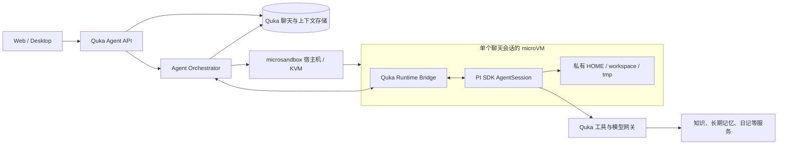

# Quka 云端 Agent 与 Sandbox 架构设计

状态：方案草案  
更新时间：2026-10-10

## 1. 决策摘要

1. **Quka 服务端是聊天记录的唯一权威存储。** 用户消息、助手消息、工具和子 agent 事件，以及会话状态，均由 Quka 持久化并提供历史查询。PI 不保存权威聊天记录。
2. **PI agent 进程运行在 sandbox 内。** 编排、身份校验、持久化和 sandbox 管理运行在 VM 外的可信 Quka 服务中。PI 的模型调用、扩展、skills、工具与运行时文件全部处于同一会话的 sandbox 边界内。
3. **每个聊天会话一个 microVM。** 不同用户、不同会话不共用 VM、可写目录或卷。子 agent 初期可在其所属主会话 VM 内运行；如果子任务需要更强的独立性，再单独分配 VM。
4. **PI 是首选 harness 实现，不是系统数据模型。** Quka 定义自己的 Agent Runtime 接口及事件协议，便于更换 harness。
5. **Quka 长期记忆与 PI 上下文分开。** Quka 的 `/memory/*` 继续承担可跨会话使用的长期记忆。PI 对话上下文只服务于该聊天会话，并作为版本化检查点保存在 Quka 服务端。

## 2. 目标与边界

主要目标是防止一个用户的 harness 读取另一用户运行过程中产生的会话、记忆缓存、下载、生成物或临时文件。隔离必须覆盖整个 harness 进程，而不只是 shell 工具。

该方案假设 Quka 服务端和 sandbox 宿主机是可信控制面。microVM 阻止 guest 访问宿主机与其他 guest，但无法防止已获授权的 agent 读取本会话提供给它的数据，也无法替代 Quka 对用户、space 和具体工具的业务授权。云端 VM 不能直接访问用户电脑的文件和应用；桌面本机操作需要另设受控连接器，或暂由本地能力承担。

## 3. 组件与部署位置

| 组件 | 位置 | 职责 |
| --- | --- | --- |
| Agent API | VM 外，Quka 服务端 | 用户认证、space 权限、会话与附件 API |
| Agent Orchestrator | VM 外，可信控制面 | 分配 VM、调度、配额、恢复、终止、事件转换 |
| Quka Runtime Bridge | VM 内 | 使用 PI SDK，收发请求与事件，管理内存会话 |
| PI AgentSession | VM 内 | 模型循环、上下文、工具及扩展运行 |
| Quka 工具网关 | VM 外 | 检查会话作用域，执行知识与记忆等业务操作 |
| microsandbox | 具备 KVM 的 Linux 宿主机 | microVM 隔离、资源及网络限制 |

**不采用“PI 在宿主机、仅工具在 sandbox”作为第一版。** PI 本身可写会话文件、加载扩展并访问运行环境；那样会留下共享宿主机上的文件与进程隔离缺口。PI 官方也说明它没有内建权限隔离，进程默认拥有启动它的系统权限。

初期建议在 VM 内运行一个 Node.js `Quka Runtime Bridge`，直接使用 PI SDK，而不是把 PI CLI 作为外部进程管理。桥接进程使用 microsandbox 的 streaming exec 与 stdin pipe 和 Orchestrator 通信；在 guest 内使用无 TTY 的严格帧协议。SDK 的 `SessionManager.inMemory(cwd, options, entries)` 支持从 Quka 提供的记录创建会话。长连接、背压、重连和异常退出仍须通过原型验证。

## 4. 数据所有权和存储

### 4.1 两种服务端记录

Quka 保存两份用途不同的数据：

| 数据 | 权威位置 | 用途 |
| --- | --- | --- |
| 产品聊天记录 | Quka 数据库 | 前端历史、搜索、分享权限、审计、跨设备访问 |
| PI 上下文检查点 | Quka 数据库或受控对象存储 | 重建 PI 的模型上下文、工具结果、压缩摘要和分支状态 |

**PI 上下文检查点不是另一套用户聊天记录。** 它是内部运行状态，可以包含系统提示词、模型输出、工具参数与结果等敏感内容。检查点必须带 `user_id`、`space_id`、`session_id`、harness 版本、schema 版本、递增 revision 和校验值，并采用与聊天记录相同或更严格的访问控制、加密和保留期限。客户端不能直接下载该检查点。

PI 的 `SessionManager` 是模型上下文的权威对象；简单地把前端展示的文本消息塞回 `agent.state.messages`，无法可靠恢复工具调用、压缩、分支和系统提示词。Bridge 在每轮稳定结束后从 `getHeader()` 与 `getEntries()` 导出完整的 PI 上下文，在 Quka 服务端提交检查点。恢复时使用 `SessionManager.inMemory(..., entries)` 重建；字段兼容性由固定 PI 版本和迁移测试保证。

### 4.2 文件类别

| 文件 | 位置 | 处理方式 |
| --- | --- | --- |
| 会话中的下载、代码、生成物 | 该 VM 私有 workspace | 用户明确保存或下载时经 Quka 文件 API 导出；否则随 VM 删除 |
| 临时文件、缓存、日志 | 该 VM 私有可写层或 tmp | 设置空间上限和清理时限；不得进入共享卷 |
| 产品长期记忆 | Quka `/memory/*` | 按 Quka 用户及 space 权限存储和检索 |
| PI 运行时设置、skills | 固定镜像的只读内容；必要时会话私有写入层 | 不共享可写目录；用户扩展作为独立版本化输入 |
| PI 会话文件 | 默认不启用持久文件会话 | 使用内存 SessionManager；若依赖写入磁盘的第三方扩展，文件只留在该 VM 私有层 |

不能把所有用户挂到一个含用户子目录的共享可写卷，再依赖目录权限隔离。microsandbox 文档明确指出，共享可写卷会打通 sandbox 之间的文件隔离。第一版不挂载任何跨会话可写卷。

## 5. 消息、事件与检查点流程

### 5.1 新消息

1. 客户端提交 `session_id`、`message_id` 和正文。Quka 校验当前用户对 session、space 的访问权，并用 `message_id` 去重。
2. Quka **先持久化用户消息和 pending turn**，再向 Orchestrator 下发请求。请求携带服务端生成的 `run_id` 与 `attempt_id`。
3. Orchestrator 启动或恢复该会话专属 VM，把最近已提交的 PI 检查点交给 Bridge，并发送本次 prompt。
4. Bridge 订阅 PI 事件。Orchestrator 为事件分配服务端递增 `event_seq`，持久化后再推送给客户端。客户端断线后按 `event_seq` 补读。
5. PI 的 `message_end`、工具结束等事件分别更新对应消息；仅在 `agent_settled` 后将整轮标为完成，并提交新的 PI 上下文检查点。`agent_end` 可能后续仍有自动恢复或排队工作，不能作为 Quka 的 `EVENT_TURN_DONE`。

产品聊天记录与检查点的提交需要可恢复的一致性约束：一个 turn 的 `completed` 状态只能指向已提交且可读取的检查点 revision。如果检查点放在对象存储，先写入不可变对象，再在 Quka 数据库事务中更新检查点指针和 turn 状态。数据库记录是权威；孤儿对象由后台清理。

### 5.2 故障与恢复

- **客户端断线**：VM 可继续执行；客户端重连后先读 Quka 已持久化事件，再接实时流。
- **VM 空闲关闭**：Quka 保留聊天和最近的 PI 检查点；下次消息启动新 VM，从检查点恢复。
- **VM 在执行中崩溃**：Quka 保留已收到的事件，把该 attempt 标为 interrupted/failed。默认不自动重放已执行过工具的 prompt，以免重复产生外部副作用。用户明确重试时创建新 attempt，并使用幂等键或人工确认处理写操作。
- **检查点损坏或 PI 版本不兼容**：保留完整聊天历史供用户查看；停止自动续跑，提供受控的上下文重建或新会话方案，不能默默丢弃工具结果后继续。

PI 检查点至少在每次成功 `agent_settled` 后保存。若一轮很长，可增加中间检查点，但必须标记为非终态，并在恢复时遵守工具调用的幂等边界。

## 6. 权限和安全边界

### 6.1 VM 创建策略

- 一会话一 VM，所有 `HOME`、`XDG_*`、`TMPDIR`、PI agent 目录和工作目录指向 VM 私有路径。
- 使用固定 digest 的镜像、非 root 用户、restricted profile；设置 CPU、内存、可写盘、最大时长和空闲超时。
- 禁止挂载宿主机用户目录、宿主机密钥、跨会话可写卷及 Docker socket。
- 网络默认拒绝，只放行受控模型网关与 Quka 工具网关。禁止访问宿主机、其他 VM、内网和云 metadata 地址。
- 用户上传文件经 Quka 校验和复制后进入本会话 VM；导出文件反向通过 Quka 授权和扫描流程。

### 6.2 凭据与业务授权

不要将用户原始 Quka 登录 token、数据库凭据或模型 API key 写入 VM 文件或 PI 配置。模型调用优先经过宿主侧代理或 microsandbox 的限定目标主机密钥注入。Quka 业务工具只能使用短期、限定 `user_id + space_id + session_id + allowed_tools` 的能力凭据；服务端每次调用仍检查目标资源和权限。需要明确接受一个边界：agent 可使用被授予的工具权限，sandbox 只阻止其越过授权范围，不能保证它不误用本会话已授权数据。

工具写操作、删除和长期记忆写入应在 Quka 工具网关实施审批与幂等控制。PI 的 `tool_call` 扩展可用于提示和拦截，但不能作为唯一安全边界；PI 扩展本身和 agent 在同一进程内。Quka 原有桌面 sudo 密码流程不应照搬到云端 VM。

### 6.3 租户标识

业务隔离至少使用 `user_id + space_id + session_id`，而不只使用 `space_id`：同一协作 space 的不同用户也可能拥有私有运行文件。Quka 长期记忆如需共享，应依原有 `user_space` / `space_shared` 语义明确授权，不能因为两人属于同一 space 就共享 harness 文件。

## 7. 与现有 Quka 的关系

前端已有 assistant、tool、agent 和 turn 事件类型，可作为首版兼容目标。当前 Wails/Hermes 只在桌面环境可用，且本地 Go 层负责会话历史和桥接事件；云端实现需把这部分责任移到 Quka Agent API 与 Orchestrator。新聊天会话可走云端路径，旧 Hermes 会话先保持历史可读，不直接迁移其内部运行状态。

`quka-ai`、`quka-journal` 等 Hermes skills 中的业务能力应抽成 Quka 工具网关接口，而不是把当前本地配置文件和用户 token 原样复制到 VM。子 agent 的卡片与事件模型可保留，但调度应由 Quka 明确记录 parent run、node 与权限范围。

## 8. 待验证的技术关口

1. **长连接**：microsandbox streaming exec + stdin pipe 能否稳定承载 Bridge 的双向协议；验证无 TTY 的 framing、背压、取消、重连和宿主进程重启。
2. **PI 上下文恢复**：固定版本下 `SessionManager.inMemory(..., entries)` 导出/重建能否保留工具结果、压缩摘要、分支与扩展状态；跨版本升级如何迁移。
3. **隔离测试**：两个不同用户并发运行，尝试通过路径、符号链接、共享卷、网络与文件导出读取对方数据。
4. **容量测试**：测量 VM 冷启动、单机并发、会话空闲回收、每轮检查点大小及对象存储成本。不要用上游宣称的启动时间代替本项目实测。
5. **权限测试**：模拟伪造 `session_id`、`sandbox_id`、下载路径、工具参数与过期能力凭据，确认服务端逐次拒绝。

在这些关口通过前，microsandbox 与 PI 版本均需固定，不应直接承载所有用户会话。PI 的 CLI、RPC 或 SDK 具体接入方式可以按第一项原型结果调整，但 **PI 进程位于 VM 内、Quka 服务端拥有聊天记录** 这两个边界保持不变。

## 9. 参考资料

- [PI SDK 与内存 SessionManager](https://github.com/earendil-works/pi/blob/main/packages/coding-agent/docs/sdk.md)
- [PI SessionManager 源码](https://github.com/earendil-works/pi/blob/main/packages/coding-agent/src/core/session-manager.ts)
- [PI 会话格式](https://github.com/earendil-works/pi/blob/main/packages/coding-agent/docs/session-format.md)
- [PI 的权限与隔离说明](https://github.com/earendil-works/pi#permissions--containerization)
- [microsandbox 隔离边界](https://docs.microsandbox.dev/security/isolation)
- [microsandbox 文件系统与共享卷](https://docs.microsandbox.dev/security/filesystem)
- [microsandbox 命令流](https://docs.microsandbox.dev/sandboxes/commands)
- Quka 当前实现：`src/types/chat.ts`、`src/apis/hermes-desktop.ts`、`quka-desktop/hermes.go`、`quka-desktop/hermes-runtime/plugins/qukaai/README.md`
